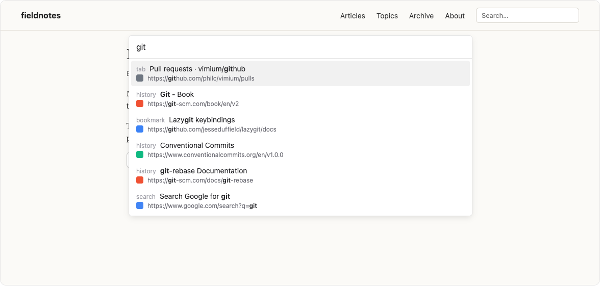
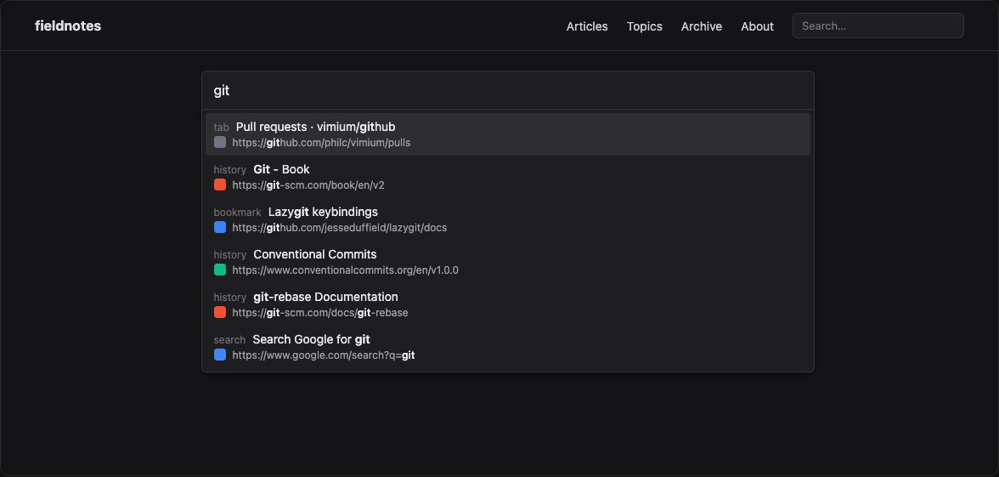
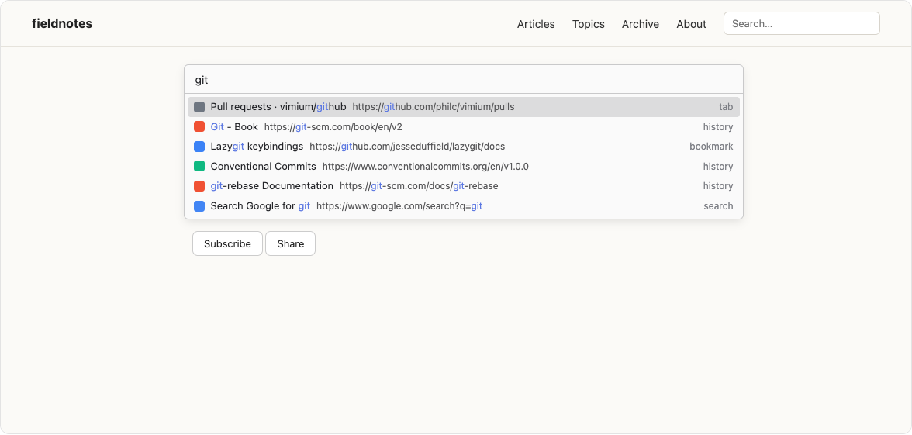
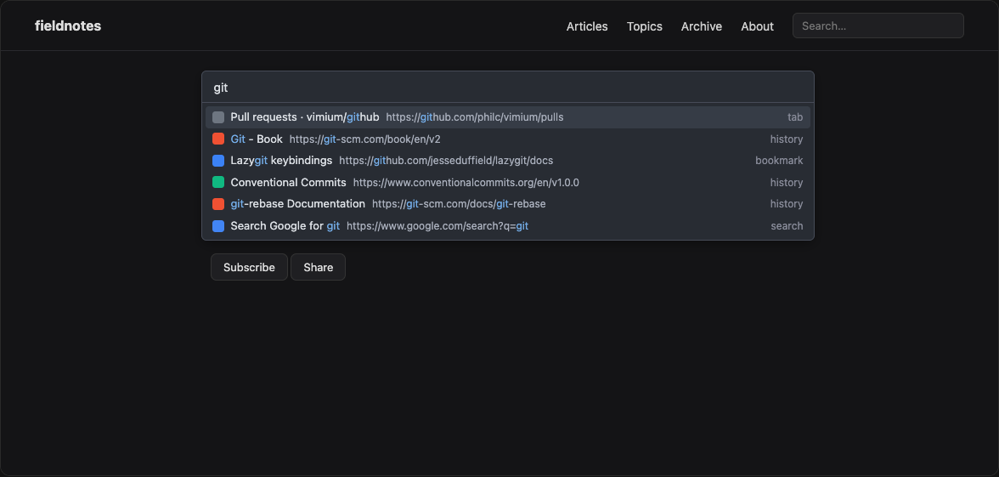

[](https://github.com/slavafyi/vimium-themes/actions/workflows/ci.yml) [](https://github.com/slavafyi/vimium-themes/releases/latest) [](https://github.com/slavafyi/vimium-themes/actions/workflows/preview.yml)

# Vimium Themes

Minimal CSS themes for [Vimium]. Each theme supports light and dark mode and follows your browser or system color scheme.

## Themes

- `minimal`: flat, neutral surfaces, dark-on-light / light-on-dark hint labels, and a blue accent used only for focus and links.
- `zed`: colors from Zed's default One Light / One Dark themes, a compact Vomnibar with one-line results, and blue matched characters.

|           | Light                                        | Dark                                       |
| --------- | -------------------------------------------- | ------------------------------------------ |
| `minimal` |  |  |
| `zed`     |          |          |

**[Open the preview](https://slavafyi.github.io/vimium-themes/)** to see every styled part. It follows your system light or dark mode.

## Installation

1. Open the Vimium options page: right-click the Vimium toolbar icon and choose **Options**.
2. In **Advanced Options**, find **CSS for Vimium UI**.
3. Replace the field's contents with the contents of a theme file, for example [themes/minimal.css](themes/minimal.css). Theme files are also attached to each [GitHub release](https://github.com/slavafyi/vimium-themes/releases).
   On macOS you can copy it with `pbcopy < themes/minimal.css`.
4. Click **Save changes**.
5. Reload open tabs. Vimium adds the CSS when a page loads, so tabs that were already open keep the old style until they reload.

To go back to the default look, click **Reset** under the field and save.

## What is styled

- Link hints, input hints, and the find-mode highlight
- Vomnibar
- HUD (find bar and status messages)
- Help dialog
- Options page
- Commands page

The toolbar popup is not styled, because Vimium does not load custom CSS there.

## Light and dark mode

Colors are CSS custom properties (`--vx-*`) at the top of each theme. A `@media (prefers-color-scheme: dark)` block swaps them, so the theme follows your browser's appearance setting, which usually follows the system. The page you are on does not affect it.

## Customization

Edit the `--vx-*` values at the top of the theme before pasting it. For example, to change the accent color, set `--vx-accent` in both the light block and the dark block.

Vimium injects this CSS into every web page as well as its own pages. Every rule targets only Vimium's own classes and structures, so websites are not affected.

## Compatibility

Made for Vimium 2.4.x. The themes use CSS nesting and `:has()`, which all current browsers support.

## Credits

- [Vimium] by Phil Crosby, Ilya Sukhar, and contributors. [preview.html](preview.html) includes Vimium's stylesheets and markup (MIT License) so it renders like the extension.
- `zed` colors are from the One themes in the [Zed] editor.

[Vimium]: https://github.com/philc/vimium
[Zed]: https://zed.dev

## Development

```sh
pnpm install
pnpm fmt        # format all files
pnpm fmt:check  # check formatting
pnpm lint       # lint the themes with Stylelint
pnpm release    # bump the version and tag a release
```

Pushing a tag runs the release workflow, which creates a GitHub release with the theme files.

## License

MIT License - see [LICENSE](LICENSE) for details.
